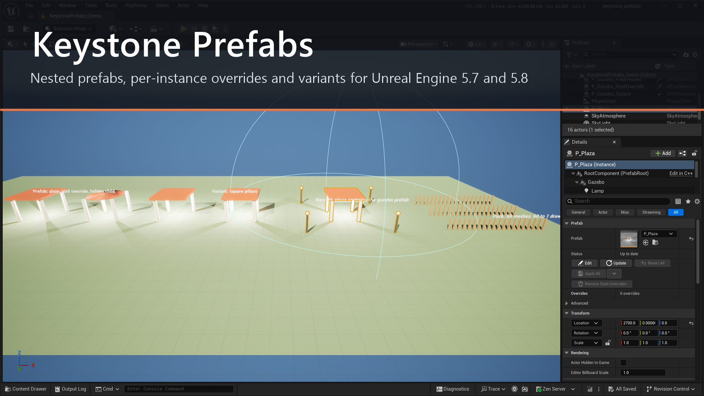
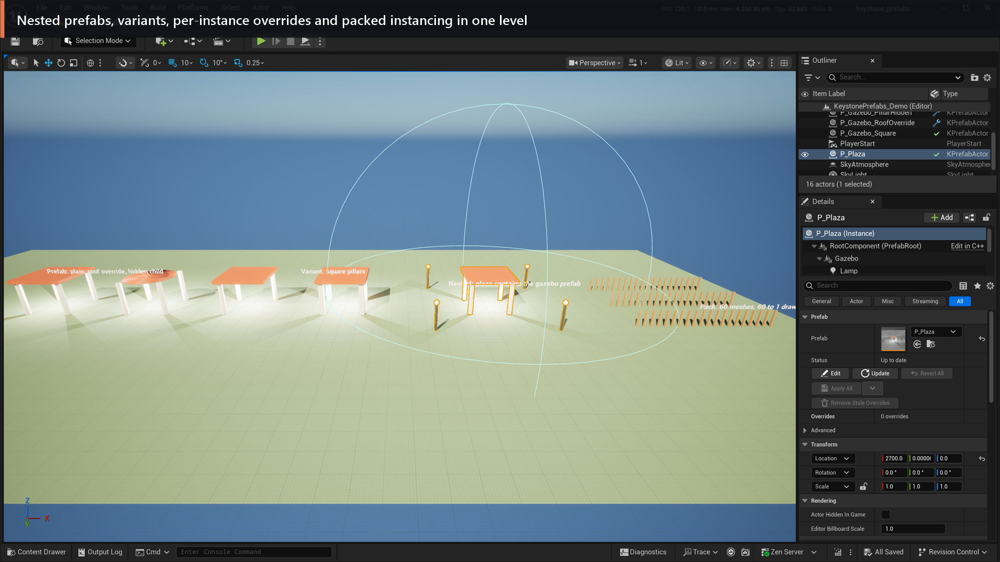
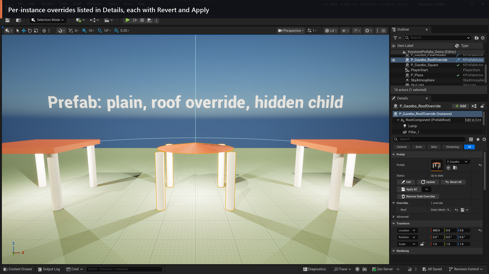
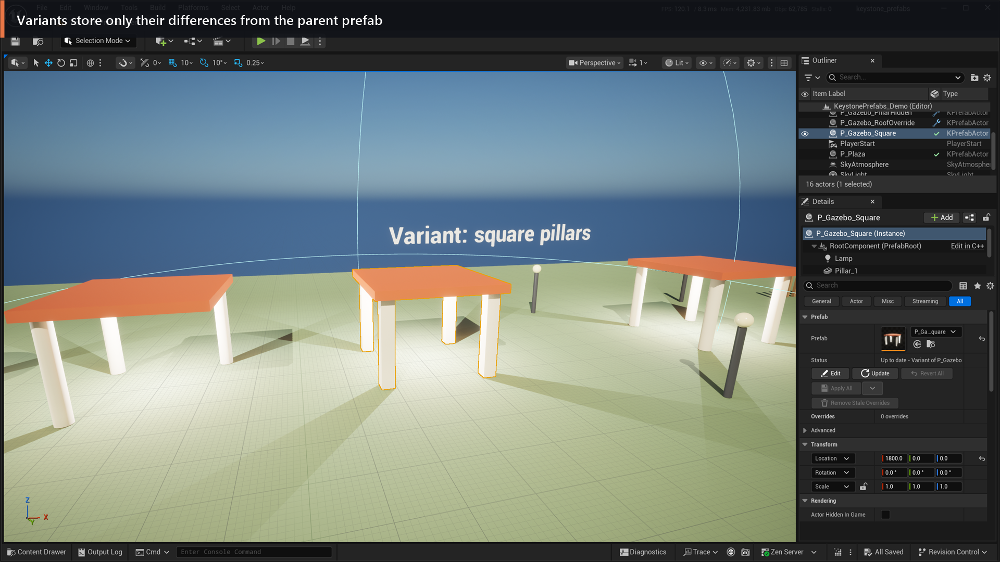
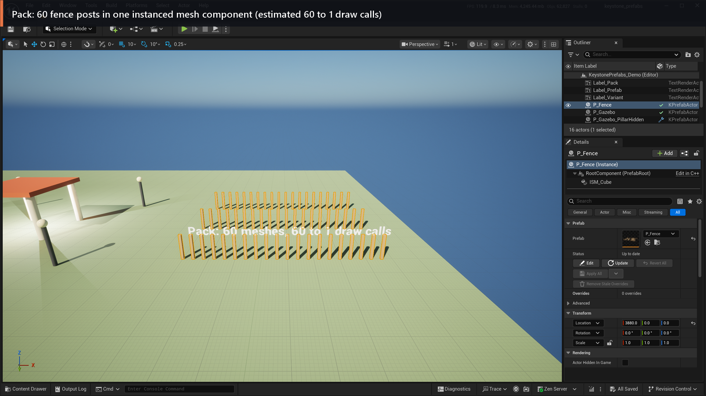
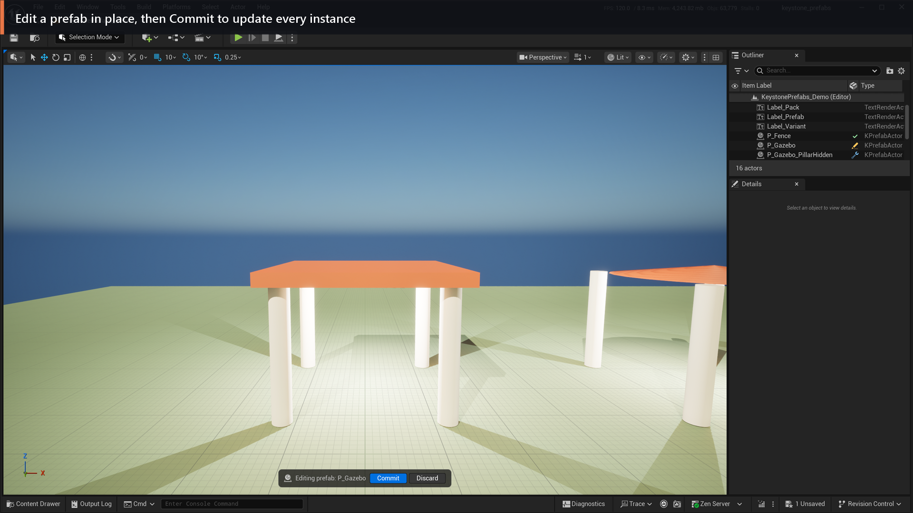
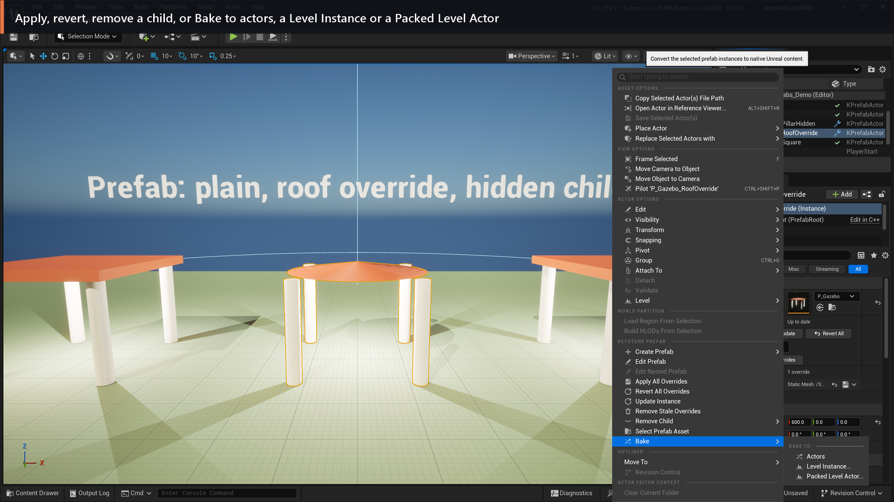

# Keystone Prefabs documentation

Keystone Prefabs adds prefabs to Unreal Engine 5.7 and 5.8 (Win64 editor): nested prefabs, per-instance overrides with Apply and Revert, prefab variants, ISM/HISM components inside prefabs, a Pack step that turns static meshes into instances, and a Bake step that exports to plain actors, Level Instances or Packed Level Actors.

This repository contains the user documentation and screenshots only. The plugin is distributed through Fab.

## Pages

| Page | Contents |
|---|---|
| [Quick start and reference](index.md) | Install, create, place, edit, overrides, variants, nesting, ISM/HISM, Pack, Bake, runtime spawning, Health report, updating instances |
| [Coming from Unity](coming_from_unity.md) | Unity prefab concepts mapped to Keystone Prefabs |
| [Coming from Prefabricator and Level Instances](coming_from_prefabricator_and_level_instances.md) | Differences from Prefabricator and native Level Instances |
| [Source control behaviour](source_control.md) | Which files each operation changes |
| [Python and CI](python_and_ci.md) | Python API, regression tests, `UpdatePrefabInstances` commandlet |
| [Limitations](limitations.md) | What 1.0 does not do |
| [FAQ](faq.md) | Common questions |
| [Screenshots](gallery.md) | The demo map in the editor |

## Supported engines

UE 5.7 and 5.8, Win64 editor; built and tested on UE 5.7.4 and 5.8.4. Packaged games: Win64. See [Limitations](limitations.md).

## Screenshots

| | |
|---|---|
|  |  |
|  |  |
|  |  |

All screenshots are taken from the demo map that ships with the plugin (`/KeystonePrefabs/Demo/Maps/KeystonePrefabs_Demo`) in the UE 5.8.4 editor.

Workflow inspired by Unity prefabs and prefab variants.
