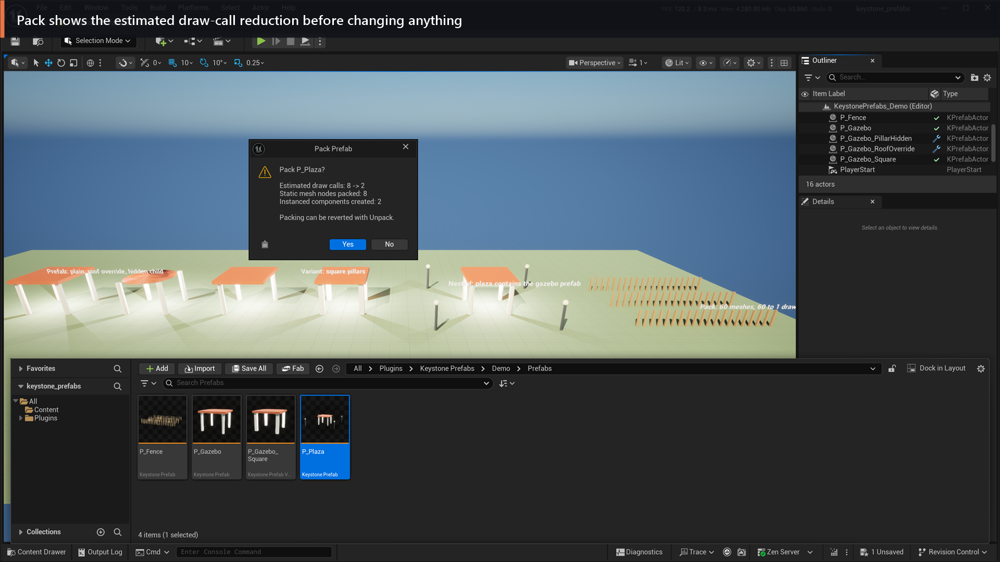
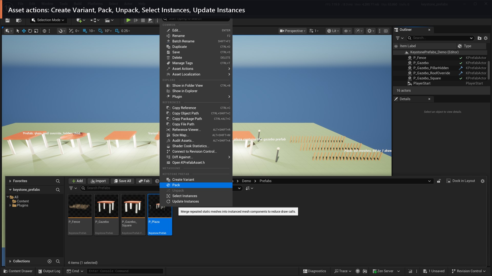
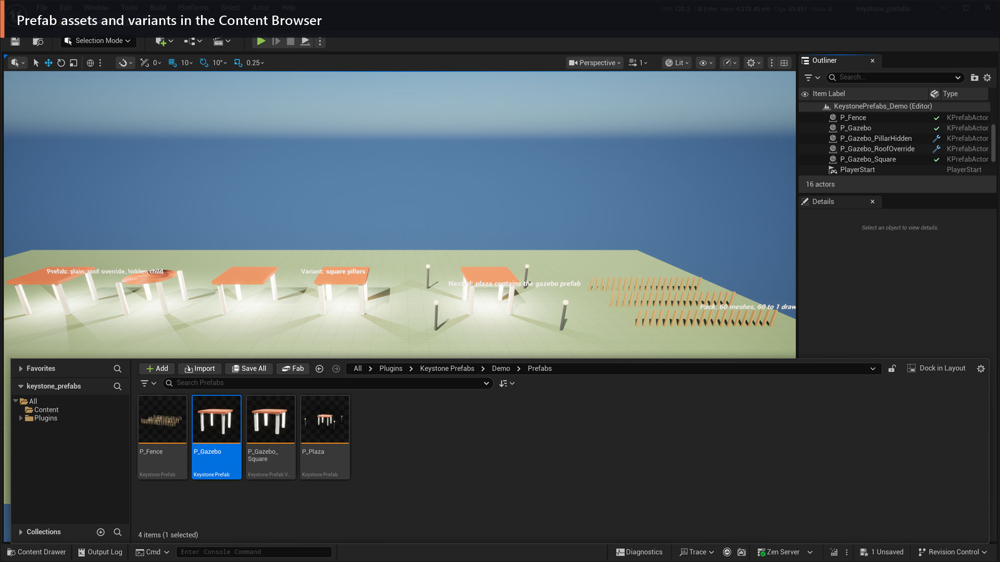

# Screenshots

Taken from the demo map that ships with the plugin (`/KeystonePrefabs/Demo/Maps/KeystonePrefabs_Demo`; in the Content Browser, enable *Show Plugin Content*) in the UE 5.8.4 editor. Each section links to the matching part of the [documentation](index.md).

## Overview

Nested prefabs, variants, per-instance overrides and packed instancing in one level. The selected instance is the nested prefab `P_Plaza`; the Outliner shows the prefab status column and the Details panel shows the *Prefab* category.

## Overrides

The roof of this instance was changed to a cone. The Details panel lists the override with Revert and Apply. See [Overrides](index.md#5-overrides).

## Variants

A variant with square pillars next to its parent. A variant stores only its differences from the parent prefab. See [Variants](index.md#7-variants).

## Pack

60 fence posts packed into one instanced mesh component; the demo label shows the estimated draw calls before and after. See [Pack and Unpack](index.md#10-pack-and-unpack).

The Pack command shows the estimate before it changes the asset:

## Edit in place

Editing the prefab in the level; Commit writes the changes to the asset and updates every instance, Discard throws them away. See [Edit, Commit, Discard](index.md#4-edit-commit-discard).

## Menus

Actor context menu with the *Keystone Prefab* section and the Bake submenu. See [Bake to native](index.md#11-bake-to-native) and [Remove Child](index.md#6-remove-child-hide-or-delete).

Prefab asset menu in the Content Browser:

## Content Browser

Prefab assets and a variant with thumbnails.

